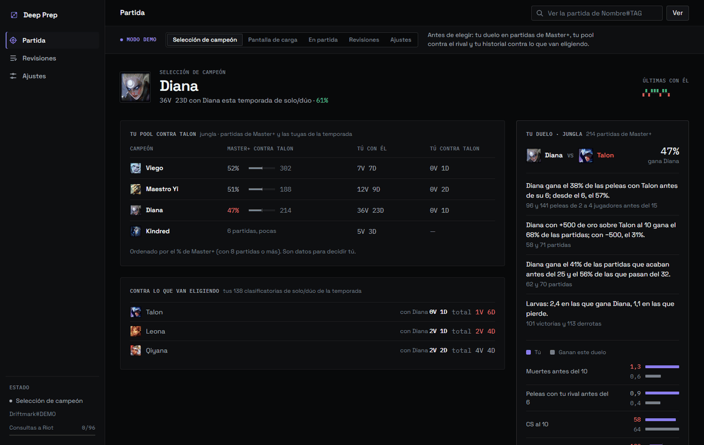
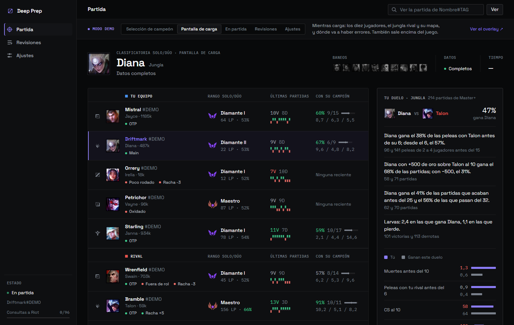
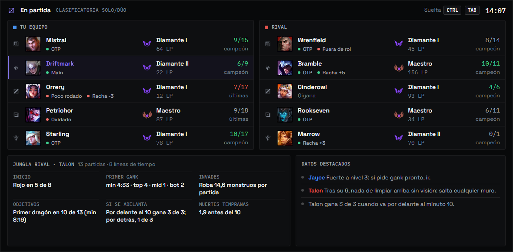
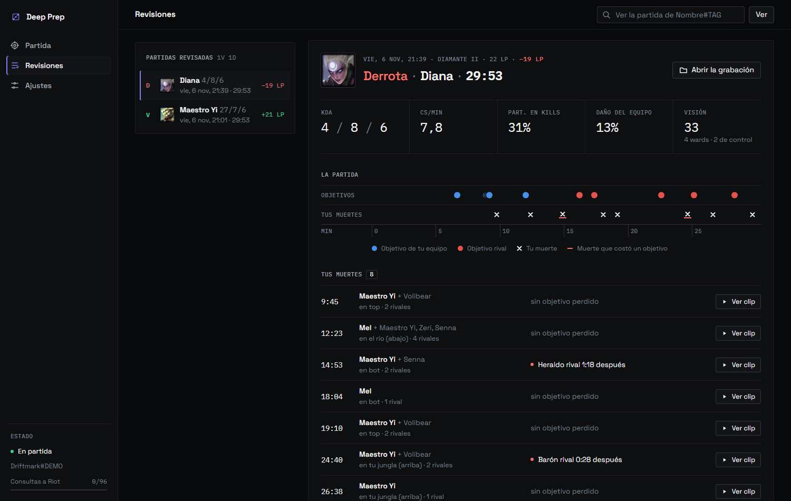

#  Deep Prep

App de escritorio para Windows que prepara cada partida de League of Legends con datos de partidas de Master+ y la revisa sola al acabar.

[](https://github.com/Samuelmartinezduran/deep-prep/actions/workflows/ci.yml)
[](https://www.python.org/downloads/)
[](LICENSE)

**205 pruebas de Python · 95 del panel en JavaScript · 73,7 % de cobertura · mypy estricto · ruff sin avisos · CI en Windows**

> **In English.** Deep Prep is a Windows desktop companion for League of Legends, built for high-elo players and especially junglers. Before the game it shows matchup data measured on Master+ games and a panel of all ten players, including where the enemy jungler usually is at minutes 2–6; in game, a separate always-on-top window shows only pre-game data, as Riot's third-party policy requires; after the game it reviews each death and what it cost, and cuts a clip of each one from the recording.
> Python 3.14, pywebview, a local HTTP server with vanilla JS modules, SQLite and FFmpeg; code and UI are in Spanish, MIT licensed. Try it without the game or a Riot key: `py -m deepprep --demo`.



<sub>El modo demo en 14 segundos: selección de campeón, pantalla de carga (el mapa del jungla rival, minuto a minuto), la ventana de encima del juego y la revisión.</sub>

## Qué hace

Acompaña cada partida en tres momentos. Lee el cliente del LoL para saber en qué fase estás y pide los datos a la API de Riot con tu propia clave.

### 1. Antes de la partida

- **Selección de campeón.** Tu duelo contra el rival de tu posición, medido en partidas de Master o más de los últimos 45 días: peleas por nivel, cuánto se gana con ventaja de oro al minuto 10, si escala y la build más jugada. Al lado, tu pool contra su campeón y tu historial contra lo que van eligiendo. En esta fase no se pide nada a Riot: todo sale de bases locales.
- **Pantalla de carga.** Los diez jugadores con rango, maestría, forma reciente, grupos premade y quién va fuera de rol. El jungla rival tiene su perfil (por dónde empieza, dónde da el primer gank, cuánto invade) y un mapa de dónde estaba en sus partidas a cada minuto del 2:00 al 6:00, girado al lado del mapa que le toca hoy.



### 2. En partida

Una ventana aparte, encima del juego, que deja pasar los clics y no coge el foco. Sale mientras mantienes **Ctrl+Tab** (se cambia en Ajustes) y solo enseña datos de antes de empezar: ni plan, ni veredictos, ni el mapa del jungla.



### 3. Después de la partida

Graba cada partida en la Grieta y, cuando Riot la publica, la revisa: cada muerte con quién la causó, dónde y si costó un objetivo; los objetivos en una línea de tiempo; oro, CS y experiencia contra tu rival al 10 y al 15; qué acertó y qué falló el panel; los LP ganados o perdidos, y un clip de cada muerte (20 s antes y 4 s después) recortado de la grabación. Con las revisiones salen tus tendencias de la temporada: por hora, por duración y después de ganar o de perder.



## Pruébalo en un minuto

El modo demo abre la app con una partida de ejemplo. No necesita el LoL ni una clave de Riot.

**Desde una versión publicada.** Descarga `DeepPrep-x.y.z.zip` de [Releases](https://github.com/Samuelmartinezduran/deep-prep/releases), descomprímelo y, en esa carpeta:

```powershell
.\DeepPrep.exe --demo
```

**Desde el código** (Windows y Python 3.14):

```powershell
git clone https://github.com/Samuelmartinezduran/deep-prep.git
cd deep-prep
py -3.14 -m venv .venv
.venv\Scripts\activate
py -m pip install -e .
py -m deepprep --demo
```

Una barra en la parte de arriba del panel cambia de escena: selección de campeón, pantalla de carga, en partida, revisiones y ajustes. En la carga y en partida hay un enlace al overlay. Las revisiones salen de una partida real anonimizada con el mismo código que las de verdad, y en partida el panel pasa por el mismo filtro de las normas de Riot que la app.

La demo no arranca el vigía del cliente, la grabación, el recolector ni el actualizador, no llama a la API de Riot y no se instala ni toca accesos directos o el arranque con Windows. Lo que se guarda en Ajustes va a una carpeta temporal nueva que se borra al cerrar; `tests/test_demo.py` lanza la demo en otro proceso y comprueba que no escribe fuera de ella. Solo los retratos de los campeones vienen de Data Dragon: sin red, la demo funciona igual, con los huecos grises. Con `py -m deepprep --demo --sin-ventana --puerto 5252` no abre ventana y se ve en el navegador, en `http://127.0.0.1:5252/`.

## Normas de Riot

Las normas de Riot para apps de terceros dejan preparar la partida y revisarla, pero ya jugando una app no puede sacar conclusiones por ti ni decirte qué hacer. Por eso:

| Momento | Qué se enseña |
|---|---|
| Selección y pantalla de carga | Todo: datos, avisos, perfil y mapa del jungla rival, tu duelo |
| En partida | Solo datos de antes de empezar y solo mientras mantienes el atajo. Sin plan, sin veredictos de línea, sin duelo, sin el mapa del jungla y sin colores de alerta |
| Después de la partida | La revisión, con conclusiones |

El recorte se hace en un solo sitio del backend (`app.para_el_modo`), antes de enviar el estado a las ventanas: ni el panel ni el overlay reciben lo que no se puede enseñar, y una prueba de caracterización fija lo que sale. La app tampoco toca el juego: no lee su memoria, no inyecta nada, no instala ganchos de teclado (el atajo se consulta con `GetAsyncKeyState`) y al cliente solo le hace peticiones GET. Es la lectura que hace el autor de las normas; Riot no ha revisado la app.

## Cómo está hecha

- **Una sola dependencia de ejecución:** `pywebview` 6.2.1. Lo demás es biblioteca estándar (`http.server`, `sqlite3`, `urllib`, `ctypes`): 34 módulos de Python con unas 7 900 líneas y 19 módulos ES de JavaScript con unas 1 300, sin bundler ni npm.
- **Interfaz web servida en local.** Un `ThreadingHTTPServer` en `127.0.0.1` y dos ventanas de WebView2 (panel y overlay) sobre la misma página. Cada petición comprueba `Host` (contra el DNS rebinding) y, si trae `Origin`, que sea el propio panel (contra el CSRF: los navegadores lo ponen en todo POST), para que otra web abierta en el navegador no pueda usar la API; los archivos se sirven desde una lista blanca.
- **Overlay sin tocar el juego.** Una ventana Win32 con `WS_EX_LAYERED`, `WS_EX_TRANSPARENT` y `WS_EX_NOACTIVATE`, siempre encima, y el atajo leído cada 30 ms sin ganchos de teclado.
- **Cuota de Riot repartida por prioridad.** Una partida con la caché vacía cuesta unas 270 peticiones y la clave personal da 100 cada 2 minutos. Un limitador de ventana deslizante por host, que se sincroniza con la cuenta que devuelve Riot (`X-App-Rate-Limit-Count`), y una cola de 6 hilos con prioridades hacen que lo más útil llegue en la primera ventana de cuota.
- **SQLite con JSON comprimido.** Una partida terminada no cambia: se guarda para siempre, reducida a lo que se usa (de los ~850 KB de una línea de tiempo quedan posiciones y oro por minuto hasta el 15, kills y objetivos) y comprimida con zlib. Solo van en columnas los campos por los que se busca.
- **Base de duelos propia.** Un recolector recorre las ligas Challenger, Gran Maestro y Master de cuatro regiones con tu clave y saca diez registros de duelo de cada partida. No hay servidor del autor por medio.
- **Grabación en un proceso aparte.** ffmpeg captura la pantalla con DXGI (`ddagrab`), con NVENC, AMF, QSV o `libx264`, en trozos MKV de 5 minutos que se pueden leer aunque se corte la grabación. Los clips se recortan después, a prioridad mínima.
- **Actualizador propio.** PyInstaller y GitHub Releases, con huella SHA-256. Las copias de Porofesor 1.0.x se pasan solas a Deep Prep con una versión puente que muda datos, carpeta y accesos directos.

Las decisiones, con la alternativa que se descartó y lo que cuesta cada una, están en [docs/ARQUITECTURA.md](docs/ARQUITECTURA.md).

## Calidad

Medido el 6 de noviembre de 2026 sobre la rama `main`:

| Qué | Cifra | Cómo se mide |
|---|---|---|
| Pruebas de Python | 205 en 15 archivos, 7 s | `py -X utf8 -m unittest discover -s tests -t .` |
| De ellas, de caracterización | 12, contra 12 JSON esperados | `tests/test_caracterizacion.py` |
| Pruebas del panel | 95 en 9 archivos | `node --test` (Node 24, sin dependencias) |
| Cobertura de Python | 73,7 % de líneas y ramas; mínimo exigido, 70 % | `coverage run -m unittest discover -s tests -t .` y `coverage report` |
| Tipos | mypy estricto en todo `deepprep`, 0 errores en 50 archivos | `mypy` |
| Lint y formato | ruff, 0 avisos | `ruff check .` y `ruff format --check .` |
| CI | GitHub Actions: Windows con Python 3.14 (formato, lint, tipos, pruebas y cobertura) y Ubuntu con Node 24 (panel) | [`.github/workflows/ci.yml`](.github/workflows/ci.yml) |

Las pruebas usan falsos de la API de Riot, del cliente del LoL y del grabador, y bases SQLite en memoria; `test_partida_propia_de_principio_a_fin` recorre el vigía desde la sala hasta el final de la partida. Antes de reordenar el código se fijó con pruebas de caracterización lo que salía de las funciones grandes, y con esa red se partió la clase `App` (unas 1 000 líneas) en piezas y ninguna función pasa de 50 líneas. La lógica pura pasa del 93 % de cobertura (`analisis` 93,3 %, `duelos` 94,1 %, `revision` 97,1 %); lo que habla con Windows o con la red se queda muy por debajo (`ventanas` 0 %, `lcu` 18,5 %, `grabacion` 36,9 %) y se prueba a mano con el cliente real.

## Estructura del repositorio

```text
deep-prep/
├── deepprep/              paquete de la app (py -m deepprep)
│   ├── app.py             composición: crea las piezas y las conecta
│   ├── analisis.py        perfil del jungla rival e historial (lógica pura)
│   ├── duelos.py          duelos de Master+ (lógica pura)
│   ├── revision.py        revisión de la partida (lógica pura)
│   ├── riot.py, lcu.py    API de Riot con su limitador y cliente del LoL
│   ├── cache.py, ...      SQLite, configuración, Data Dragon
│   ├── overlay.py, grabacion.py, clips.py   Windows: overlay, grabación y recortes
│   ├── servidor.py        API JSON y archivos del panel en 127.0.0.1
│   ├── demo/              modo demo: AppDemo y la partida de ejemplo en JSON
│   └── web/               panel: index.html, estilo.css, js/ (módulos ES) y fuentes
├── tests/                 unittest, con datos anonimizados en tests/datos; tests/js con node --test
├── herramientas/          publicar, maqueta, captura, anonimizar, simular una partida...
├── empaquetado/           entrada de PyInstaller y LEEME.md, la guía de instalación para jugadores
├── docs/                  ARQUITECTURA.md e imágenes
└── pyproject.toml         paquete, ruff, mypy y coverage
```

## Desarrollo

```powershell
py -3.14 -m venv .venv
.venv\Scripts\activate
py -m pip install -e ".[dev]"

py -m deepprep                                    # la app de verdad: necesita el cliente del LoL y una clave de Riot
py herramientas/maqueta.py                        # el panel de la demo en http://127.0.0.1:5252, para diseñar
py herramientas/captura.py http://127.0.0.1:5252/ panel.png   # foto del panel con Chrome sin ventana

ruff check .
ruff format --check .
mypy
py -X utf8 -m unittest discover -s tests -t .
coverage run -m unittest discover -s tests -t .
coverage report
node --test

py herramientas/publicar.py 2.0.1 "Qué cambia"    # pasa lo mismo que la CI, empaqueta y publica en GitHub Releases
```

La clave de Riot se pega en el panel la primera vez (se pide gratis en [developer.riotgames.com](https://developer.riotgames.com/)) y se guarda en `clave.txt`, en la carpeta de datos, fuera del repositorio. Para instalar la app como jugador, sin el código, está [empaquetado/LEEME.md](empaquetado/LEEME.md).

## Privacidad

- **Datos de prueba anonimizados.** Las pruebas, las maquetas y la demo salen de partidas reales. Antes de entrar en el repositorio, [`herramientas/anonimizar.py`](herramientas/anonimizar.py) cambia Riot ID, PUUID e id de invocador, de cuenta y de partida por valores inventados (`Driftmark#DEMO`, `puuid-demo-01`...), siempre los mismos para el mismo jugador, para que la partida, su línea de tiempo, el panel y la revisión sigan cuadrando.
- **Todo se queda en tu PC.** Configuración, clave, bases de datos y registros van en `%LOCALAPPDATA%\DeepPrep`, y las grabaciones en `Vídeos\LoL-coach`. No hay telemetría. Las únicas conexiones de salida son la API de Riot, Data Dragon, Meraki (roles por campeón) y GitHub (actualizaciones).
- **Cada usuario usa su propia clave de Riot.** No es un producto comercial ni hay un servidor del autor: cada uno recoge sus datos con su clave personal, que no se comparte.

## Historia

Empezó como **Porofesor**, una app que el autor hizo para uso propio y de unos amigos. La 1.0.0 (14 de octubre de 2026) traía el panel de partida, los duelos de Master+, las revisiones, la grabación y el actualizador; la 1.0.1 (29 de octubre) rehízo la interfaz y añadió tu pool en la selección de campeón, el mapa del jungla rival y los clips de cada muerte, y la 1.0.2 (el mismo día) arregló el actualizador. Para publicar el código pasó a llamarse **Deep Prep** (2.0.0, 6 de noviembre de 2026) y se rehízo por dentro sin cambiar lo que ve el jugador: de 99 pruebas a 205, tipos, registro con `logging`, el panel en módulos, CI y el modo demo. Las copias de Porofesor se actualizan solas a Deep Prep y se llevan sus datos. El detalle, en el [CHANGELOG](CHANGELOG.md).

Hecho por Samuel Martínez Durán ([Samuelmartinezduran](https://github.com/Samuelmartinezduran) en GitHub).

## Licencia

El código es [MIT](LICENSE). Las fuentes del panel (Space Grotesk e IBM Plex Mono) van con su licencia, la [SIL Open Font License](deepprep/web/fuentes/OFL.txt).

---

Deep Prep isn't endorsed by Riot Games and doesn't reflect the views or opinions of Riot Games or anyone officially involved in producing or managing Riot Games properties. Riot Games, and all associated properties are trademarks or registered trademarks of Riot Games, Inc.

Las versiones publicadas incluyen [FFmpeg](https://ffmpeg.org/) (licencia GPL v3; build «essentials» de [gyan.dev](https://www.gyan.dev/ffmpeg/builds/)) para grabar la pantalla. Su licencia va en `ffmpeg/LICENSE` dentro del zip y su código fuente está en [ffmpeg.org](https://ffmpeg.org/download.html#get-sources). Este repositorio no lo incluye: `herramientas/publicar.py` lo añade al empaquetar.
