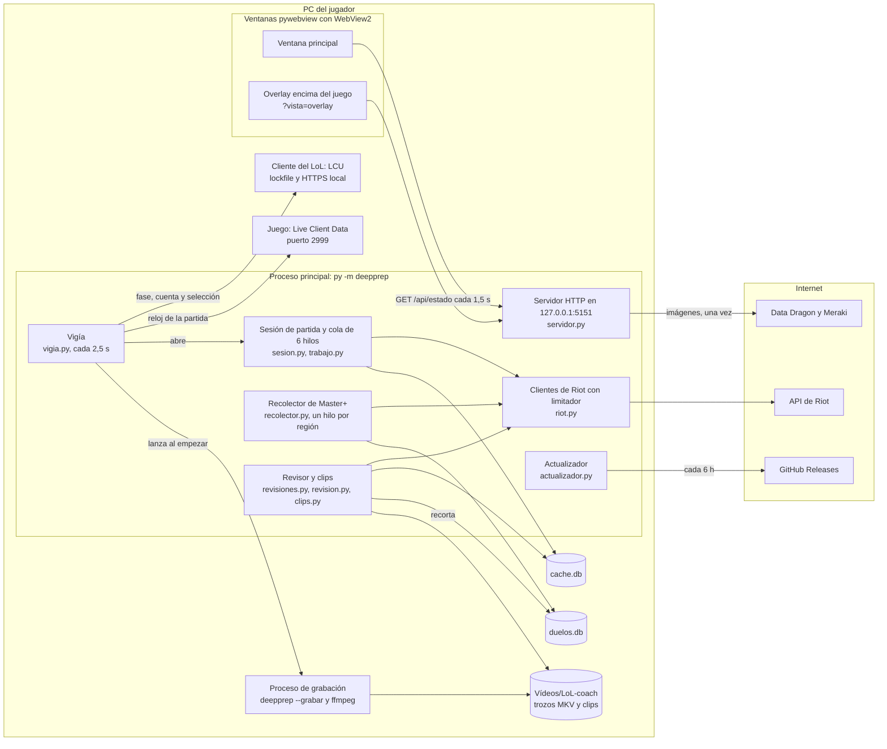
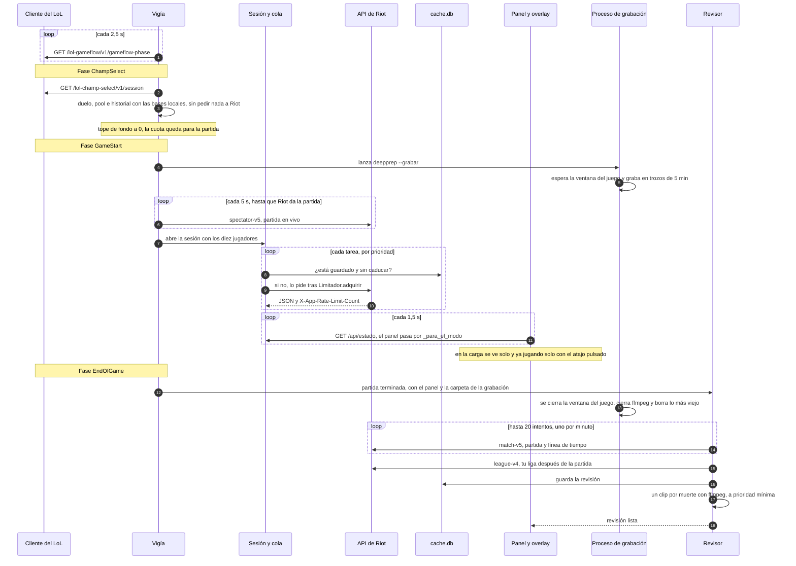

# Arquitectura de Deep Prep

Documento técnico de la versión 2.0.0 (rama `main`, 6 de noviembre de 2026). Explica cómo está hecha la app y por qué. Las cifras de la sección 5 están medidas ese día sobre la rama `main`.

Deep Prep es una app de escritorio para Windows que acompaña al jugador de League of Legends antes, durante y después de cada partida. Es un paquete de Python 3.14 (`deepprep`, 34 módulos, unas 7 900 líneas) con la interfaz en HTML, CSS y JavaScript (`deepprep/web`, 19 módulos, unas 1 300 líneas). Tiene una sola dependencia de ejecución, `pywebview` 6.2.1. Lo demás es biblioteca estándar (`urllib`, `sqlite3`, `http.server`, `ctypes`) y un `ffmpeg` que va dentro del paquete para grabar. El código y los textos están en español.

## 1. Qué hace

- Lee la API local del cliente del LoL para saber qué cuenta está abierta y en qué fase está (cola, selección, partida).
- En la pantalla de carga monta un panel de los diez jugadores: rango, maestría, forma reciente, grupos premade, perfil del jungla rival y tu duelo de línea medido en partidas de Master o más.
- Ya jugando, enseña ese panel en una ventana encima del juego, recortado a lo que permiten las normas de Riot.
- Graba la pantalla de cada partida en la Grieta del Invocador.
- Al acabar, revisa tu partida: muertes y lo que costó cada una, objetivos, comparación con tu rival y con una referencia, LP ganados o perdidos y un clip de cada muerte.

| Momento | Fuente de datos | Qué se enseña |
|---|---|---|
| Selección de campeón | API local del cliente (LCU) y bases locales | Tu duelo contra el rival probable, tu pool contra su campeón, tu historial y tus notas |
| Pantalla de carga y partida | API de Riot: spectator-v5, league-v4, champion-mastery-v4, match-v5 | En la carga, el panel completo; ya jugando, solo datos y solo mientras se mantiene el atajo |
| Después de la partida | match-v5, cuando Riot publica la partida, y la grabación | La revisión, con conclusiones, LP y clips |

## 2. Componentes

Lo que corre en cada momento:

| Proceso o hilo | Qué hace | Módulo |
|---|---|---|
| Hilo principal | Bucle de ventanas de pywebview (tiene que ir en el hilo principal) | `ventanas.py` |
| `servidor` | API JSON y archivos del panel | `servidor.py` |
| `vigia` (2,5 s) | Fase del cliente, cuenta, región, inicio y fin de partida | `vigia.py` |
| `fondo` (20 s) | Baja tus clasificatorias de la temporada | `partidas.py` |
| `trabajo-0` a `trabajo-5` | Peticiones de la partida en vivo, por prioridad | `trabajo.py`, `sesion.py` |
| `recolector-<región>` | Duelos de Master+ | `recolector.py` |
| `overlay` (30 ms) | Enseña o esconde la ventana encima del juego | `overlay.py` |
| `revision`, `clips` | Revisión al acabar y recortes de las muertes | `revisiones.py` |
| `actualizador` (6 h) | Busca, baja e instala versiones nuevas | `actualizador.py` |
| Proceso `--grabar` | Espera la ventana del juego, graba con ffmpeg y para al acabar | `grabacion.py` |

El código va por capas, de más estable a más pegado a Windows:

- **Composición.** `app.py`: `App` recibe sus piezas ya hechas (configuración, caché, datos de campeones, cliente de Riot, cliente del LoL, base de duelos, grabador) y las conecta. `crear_app()` crea las de verdad y las pruebas pasan falsos. Hasta el commit `ed193af` `App` tenía unas 1 000 líneas; ahora delega en `Cuentas`, `Partidas`, `Comparador`, `Ajustes`, `Revisor`, `Sesiones`, `Vigia` y `Seleccion`.
- **Lógica pura**, sin red ni disco: `analisis.py`, `duelos.py`, `revision.py`. Es donde está el valor del producto y donde más se prueba.
- **Datos:** `riot.py`, `lcu.py`, `ddragon.py`, `almacen.py`, `cache.py`, `base_duelos.py`, `config.py`.
- **Windows:** `overlay.py`, `ventanas.py`, `grabacion.py`, `clips.py`, `sistema.py`, `inicio_windows.py`, `actualizador.py`.
- **Interfaz:** `servidor.py` y `deepprep/web/`.

## 3. Una partida de principio a fin

Detalles que no caben en el diagrama:

- **Selección.** No se pide nada a Riot. `lcu.seleccion()` solo lee ids de campeón, la cola y tu posición; el duelo y tu pool salen de `duelos.db` y de tus partidas guardadas.
- **Carga.** Con la caché vacía, una partida cuesta unas 270 peticiones (por jugador: lista de partidas, liga, maestría y 20 partidas; además, hasta 4 líneas de tiempo por jugador y 8 del jungla rival). La clave personal da 100 cada 2 minutos, así que `Sesion` pone prioridades: lista, liga y maestría (10 a 12), las 5 primeras partidas del jungla rival (14 en adelante) antes que las del resto (20 en adelante), líneas de tiempo del jungla (30 en adelante) y las dos primeras de cada jugador (35 en adelante). Lo más útil llega en la primera ventana de cuota. El panel se vuelve a montar como mucho una vez por segundo.
- **Carga o juego.** El vigía y el overlay preguntan al juego (`/liveclientdata/gamestats`, puerto 2999) solo por `gameTime`: sin respuesta, es la pantalla de carga; con ella, ya se juega. Aparte del reloj de la partida, de esa API no se enseña nada.
- **Después.** Riot tarda unos minutos en publicar la partida; el revisor la pide con `fondo=True` y, mientras espera, el actualizador no instala. Los clips esperan si empieza otra partida.

## 4. Decisiones de diseño

### 4.1 Las normas de Riot son una restricción dura

La app no toca el proceso del juego: no lee su memoria, no inyecta nada, no instala ganchos de teclado y no automatiza el cliente (`lcu.py` solo hace GET). Vanguard, el antitrampas de Riot, funciona en modo núcleo, y cualquiera de esas técnicas pone en riesgo la cuenta. El atajo del overlay se consulta con `GetAsyncKeyState` cada 30 ms y la grabación captura la pantalla con `ddagrab` (DXGI Desktop Duplication), como un programa de streaming.

Lo que se enseña durante la partida se recorta en un solo sitio, `App._para_el_modo` (`app.py`), antes de serializar el estado: en modo `juego` se quitan el plan, los veredictos de línea, el duelo y el mapa de dónde suele estar el jungla rival en sus primeros minutos, y todos los colores de alerta pasan a neutro. Ni la ventana principal ni el overlay reciben esos datos. Antes de empezar se enseña todo; después, la revisión sí saca conclusiones. Los avisos son hechos con números, nunca órdenes; `test_ningun_texto_da_ordenes` comprueba que no vuelvan a `sesion.py` frases como «evita».

**Alternativa:** que cada vista del panel escondiera lo suyo. Se descartó porque es fácil olvidar una y el dato llegaría igual a la ventana. Un solo filtro en el backend se audita y se prueba mejor (`tests/datos/esperado/para_el_modo.json`). Esta es la lectura del autor de las normas para apps de terceros; Riot no ha certificado la app, y por eso el LEEME dice «diseñada para cumplir» y no promete que no haya sanciones.

### 4.2 Una ventana aparte encima del juego, no un overlay dentro del juego

El overlay es una ventana de pywebview sin bordes a la que `overlay.VentanaWin32` añade `WS_EX_LAYERED`, `WS_EX_TRANSPARENT`, `WS_EX_TOOLWINDOW` y `WS_EX_NOACTIVATE`: siempre encima, sin coger el foco y dejando pasar los clics. Sale sola en la pantalla de carga y, ya jugando, solo mientras se mantiene el atajo (`overlay.debe_verse`).

**Alternativa:** dibujar dentro del juego enganchándose a DirectX, como hacen algunas plataformas de overlays. Exige inyectarse en el proceso, que es justo lo que no se puede hacer. **Coste:** solo funciona con el juego en ventana sin bordes (`WindowMode=2` en `game.cfg`); en pantalla completa exclusiva el juego se minimizaría. La app lee `game.cfg` y avisa en el panel.

### 4.3 Servidor HTTP local e interfaz web, no un toolkit nativo

La interfaz es una página que sirve `servidor.py` (`ThreadingHTTPServer`) y que se ve en dos ventanas de pywebview con el WebView2 de Windows. Es la misma página para las dos (`?vista=overlay`). Cada ventana pide `/api/estado` cada 1,5 s y solo repinta si el texto ha cambiado.

Así el panel, que es denso en datos, se hace con HTML y CSS; si pywebview o WebView2 fallan, `__main__.abrir_ventana` abre el panel en Chrome o Edge en modo `--app` (sin overlay); y para diseñar no hace falta jugar: `herramientas/maqueta.py` sirve el panel con un estado guardado y `captura.py` lo fotografía con Chrome sin ventana. El puerto ocupado también sirve para detectar otra copia en marcha: se le pide que enseñe su ventana (`/api/mostrar`).

**Alternativas:** Tkinter se queda corto para este panel; Qt o Electron añaden una dependencia o un runtime de decenas de MB, mientras que WebView2 ya viene con Windows 11. **Coste:** sondeo en vez de envío (la biblioteca estándar no trae WebSocket), y una superficie HTTP local que hay que proteger (4.11).

### 4.4 Módulos ES sin paso de compilación

El panel eran 960 líneas en un `app.js`; desde `d6f6d67` son módulos en `deepprep/web/js/` (19 con el de la barra del modo demo). `index.html` carga `/js/main.js` con `type="module"` y los archivos se sirven tal cual. `estado.js` es el único estado mutable compartido. No hay dependencias de npm: `node --test` importa los mismos módulos que usa el navegador, porque ninguno toca la página al cargarse salvo `main.js`.

**Alternativa:** un bundler con un framework. Para unas 1 300 líneas añadiría `node_modules`, una cadena de compilación y un paso más al empaquetar. **Coste:** sin tipos en JavaScript y con plantillas de texto, el escapado es manual (`esc()` en `util.js`). Hubo un fallo así: el tooltip volvía a meter como HTML un texto ya escapado, y un nombre con `` se ejecutaba. `13ff2e0` lo arregló pasando el contenido como JSON y pintándolo con `textContent`, con pruebas que lo cubren.

### 4.5 SQLite y JSON comprimido

Hay dos bases: `cache.db` (partidas, líneas de tiempo y un clave/valor con caducidad) y `duelos.db` (registros de duelos). Van separadas porque el recolector suelto escribe en `duelos.db` desde otro proceso; por eso esa base espera hasta 30 s si está bloqueada. Las dos usan WAL y la clase común `almacen.BaseSQLite`: una conexión compartida por los hilos con un cerrojo.

Una partida terminada no cambia nunca, así que se guarda para siempre, reducida a lo que se usa (`analisis.reducir_partida`; de la línea de tiempo, de unos 850 KB, quedan posiciones y oro por minuto hasta el 15, kills hasta el 20 y objetivos) y como JSON comprimido con zlib en un BLOB. Solo van en columnas, con sus índices, los campos por los que se busca: id, jugador, fecha y cola en la caché; campeón, posición y rival (`a`, `pos`, `b`) en los duelos. Lo que caduca va al clave/valor con su vida: lista de partidas 5 min, ligas 30 min, maestrías 6 h, Data Dragon 12 h, ligas de élite 24 h, roles por campeón 7 días. En memoria se quedan las últimas 2 000 partidas y 300 líneas (LRU, unos 55 MB como mucho).

**Alternativa:** un esquema normalizado (participantes, eventos...). El análisis lee partidas enteras, el formato de Riot cambia con los parches y una app de escritorio no necesita consultas ad hoc. **Coste:** no se puede preguntar a SQL por lo que hay dentro del JSON; todo se agrega en Python, y cuando cambia el formato reducido hay que rellenar lo viejo (`Revisor.rellenar`). Un detalle: el PUUID depende de la clave de la API, así que si cambia el de tu cuenta principal la caché se vacía (`Cuentas.comprobar_clave`).

### 4.6 Un limitador que se sincroniza con Riot

La clave personal permite 20 peticiones por segundo y 100 cada 2 minutos por host (`euw1` y `europe` cuentan aparte). `riot.Limitador` lleva una ventana deslizante por host con margen (18 y 96) y espera antes de pasarse, en vez de dejar que Riot devuelva 429. Con cada respuesta se ajusta a la cuenta de Riot (`X-App-Rate-Limit-Count`), lo que cubre reinicios de la app y otros procesos con la misma clave, como el recolector suelto. Un 429 pausa el host lo que diga `Retry-After` más 1 s; un 5xx o un fallo de red se reintenta hasta 3 veces con espera creciente; un 401 o 403 se convierte en `ClaveInvalida`, que el panel enseña y el vigía vuelve a probar cada 20 s.

Las tareas de fondo (`fondo=True`) tienen un tope dentro de la ventana de 2 minutos que pone el vigía: 85 con el cliente abierto, 40 cerrado y 0 con la partida cerca (cola, selección, inicio). Cada petición lleva además una función `cancelada`: si la sesión ya no hace falta, deja de esperar cuota. El reloj y la espera se inyectan, así que el limitador se prueba sin dormir (`tests/test_riot.py`).

**Alternativa:** reaccionar solo a los 429. Es más simple, pero Riot advierte de que puede bloquear las claves que se pasan una y otra vez, y el panel tiene que llegar a tiempo para la pantalla de carga. **Coste:** los límites por método (`X-Method-Rate-Limit`) no se modelan; solo se respetan cuando llega un 429.

### 4.7 El recolector de Master+ y el reparto de cuota

El duelo de tu campeón contra el rival de tu posición se mide en partidas de Master o más de los últimos 45 días. De cada partida con su línea de tiempo salen diez registros, uno por jugador contra su rival de posición (`duelos.extraer`), y `duelos.analizar` calcula peleas por nivel, ventaja al minuto 10, si escala, qué hacen distinto los que ganan, dónde se muere y la build. Por debajo de unos mínimos (12 partidas, 10 peleas, 8 por grupo) un dato no se enseña.

El recolector (`recolector.py`) parte de las ligas Challenger, Gran Maestro y Master de cada plataforma (guardadas 24 h), mira 4 partidas recientes de jugadores al azar y, cuando sale alguien con un campeón de tu pool en su posición, lo sigue y mira sus 20 últimas partidas. La tabla `vista` evita mirar dos veces la misma partida. Va un hilo por región (Europa, Corea, Norteamérica y Asia-Pacífico). Las que no son la tuya tienen cuota propia y van a toda velocidad sin quitarle nada al panel. La tuya comparte cuota con el panel: solo se usa con el cliente quieto (`App._cuota_libre`: clave válida, sin partida cerca ni en curso, sin sesión cargando y con tu historial ya bajado), con `fondo=True` y cancelándose en cuanto el panel necesita la cuota. Un cerrojo (`recolector.lock`) impide dos recolectores a la vez, el de la app y el suelto (`py -m deepprep.recolector`).

**Alternativa:** un servidor propio que recogiera para todos los usuarios. Necesitaría una clave de producción de Riot e infraestructura; así, cada usuario recoge solo lo de su pool con su clave. **Coste:** la base crece despacio y depende de que la app esté abierta; por eso «siempre en marcha» viene activado y la app arranca con Windows con la ventana escondida.

### 4.8 Grabación en un proceso aparte, en trozos MKV

Al empezar una partida en la Grieta (o en un mapa que no se sabe), el vigía lanza `deepprep --grabar`. Ese proceso espera la ventana del juego (`RiotWindowClass`), elige codificador (NVENC, AMF o QSV, probados con 5 fotogramas; si no, `libx264`), busca en qué salida DXGI está el juego y graba a 30 fps en trozos de 5 minutos, con prioridad por debajo de la normal. Para cuando se cierra la ventana del juego (o a los 100 minutos) y borra las grabaciones más viejas por encima de 50 GB.

Va aparte para que la grabación siga aunque la app se reinicie o se cierre a media partida, y para que un fallo de ffmpeg o de `ctypes` no tumbe el panel. Se comunica por archivos: un cerrojo (`grabacion.lock`), un registro (`grabacion.log`, con la carpeta en curso) y `series.json`. La app mide cada 5 s cuánto ocupa el vídeo y avisa si lleva 20 s sin crecer. Los trozos son MKV porque un MKV cortado de golpe se sigue pudiendo leer, y un MP4 sin su índice final no; además, un clip solo necesita abrir uno o dos trozos. Si ffmpeg se corta (por ejemplo, al cambiar la resolución), se relanza como otra serie (`r02_seg_*.mkv`) y `series.json` apunta cuándo empezó cada una. `clips.tramo` sitúa cada muerte en su serie y su trozo y la recorta: 20 s antes y 4 s después, a 720p, con 2 hilos y prioridad mínima.

**Alternativa:** pedir al usuario que grabe con OBS (otra instalación y configuración en cada PC) o grabar desde un hilo de la app (comparte la suerte del panel). **Coste:** la comunicación por archivos es sencilla pero frágil; la carpeta en curso se saca del texto del registro.

### 4.9 Actualizador propio y paso de Porofesor a Deep Prep

`herramientas/publicar.py` pasa lo mismo que la CI (formato, lint, tipos, pruebas con cobertura y `node --test`), empaqueta con PyInstaller (carpeta, no un solo .exe) junto con ffmpeg y publica en GitHub Releases un zip y su `.sha256`. La primera vez que se abre, la app se copia a `%LOCALAPPDATA%\Programs\DeepPrep`; los datos van en `%LOCALAPPDATA%\DeepPrep`, aparte, para que una actualización no los toque. Cada 6 horas la app mira `releases/latest`, baja el zip y su huella, la comprueba y espera a poder instalar sin estorbar (`Actualizador.puede_instalar`: sin partida ni selección, sin grabación, sin revisión pendiente y sin nadie mirando la ventana). Entonces lanza la versión nueva con `--actualizar PID DESTINO`; esta espera a que la vieja se cierre, se copia encima y se vuelve a abrir.

**Lo que no protege:** la huella SHA-256 viene de la misma versión publicada que el zip. Detecta una descarga corrupta o cortada, no una versión maliciosa ni una cuenta de GitHub comprometida. El .exe tampoco está firmado, y Windows avisa al abrirlo la primera vez (el LEEME explica cómo seguir).

Hasta la 1.0.2 la app se llamaba Porofesor. Esas copias buscan actualizaciones en otro repositorio (`porofesor-descargas`) y esperan un `Porofesor.exe` dentro del zip, y eso no se puede cambiar en lo ya instalado. La solución (`9471a9a`) es una versión puente publicada allí con una copia byte a byte de `DeepPrep.exe` llamada `Porofesor.exe`; funciona porque el empaquetado en carpeta busca `_internal` junto al .exe, no por su nombre. La 2.0.0 ve que se instala encima de Porofesor, se pone en la carpeta nueva, cambia los accesos directos y borra el programa viejo si no corre nada desde él. Los datos los muda `config.elegir_datos` al arrancar, antes de abrir bases o registros: un `os.rename` y, si Windows no lo deja, una copia con `config.json` al final, como marca de que la mudanza ha terminado. `tests/test_mudanza.py` tiene 26 pruebas; las del zip puente lo abren con una copia literal de la lógica del actualizador de la 1.0.2.

**Alternativa:** pedir a los usuarios que desinstalen y vuelvan a instalar. Los usuarios son amigos del autor que reciben las versiones solas, y los que no lo hicieran se quedarían para siempre en la 1.0.x. **Coste:** hay que mantener el puente mientras quede alguna 1.0.x, y la copia encima no es atómica (sección 7).

### 4.10 Escrituras atómicas de la configuración

`config.json` y `clave.txt` se escriben desde varios hilos (servidor, vigía). Antes de `2b0939c` se escribían directamente: un archivo a medias se leía como «sin configuración» y el siguiente guardado pisaba tus cuentas. Ahora `config.escribir_atomico` escribe en un temporal de la misma carpeta, hace `fsync` y lo cambia con `os.replace`, reintentándolo si Windows dice que el archivo está ocupado (el antivirus, el proceso de grabación leyéndolo). Un cerrojo del módulo ordena lecturas y escrituras, `config.json.copia` guarda el último bueno y uno ilegible se aparta como `config.json.roto` y se recupera de la copia; si ni siquiera se puede apartar, no se escribe encima en todo el arranque.

**Alternativa:** guardar la configuración en SQLite. Se prefirió un JSON que el usuario puede leer y que el proceso de grabación lee sin abrir la base. **Coste:** algo más de 100 líneas en `config.py`, cubiertas por 11 pruebas.

### 4.11 Seguridad del servidor local

La amenaza es una web abierta en el navegador del usuario que intente hablar con `127.0.0.1:5151`, ya sea mandando peticiones (CSRF) o leyendo respuestas con DNS rebinding. La API puede cambiar la clave de Riot y los ajustes, abrir las carpetas y los clips de tus grabaciones y cerrar la app.

- Solo escucha en `127.0.0.1`.
- Cada petición comprueba que `Host` sea `127.0.0.1:<puerto>` o `localhost:<puerto>` (con DNS rebinding llega el dominio del atacante) y que `Origin`, si viene, sea el mismo (`_Respuestas._ajena`); si no, 403.
- Archivos estáticos en lista blanca: `/` y `/estilo.css` salen de una tabla; `/js/<nombre>.js` solo si el nombre es `^[A-Za-z0-9]+$`; fuentes e imágenes, resueltas y dentro de `web/` con extensiones permitidas; las imágenes de Data Dragon, por tipo y clave validados.
- `allow_reuse_address = False`: una segunda copia no puede escuchar en el mismo puerto.

Lo cubren `test_otra_web_no_puede_tocar_la_app` y `test_paginas_y_estado` (por ejemplo, `/js/..%2Fservidor.py` da 404). **Alternativa:** un token aleatorio por sesión. Protegería también frente a otros procesos locales, pero complica la comunicación entre copias y las herramientas; hoy no está (sección 7).

### 4.12 Un modo demo que no toca nada

`py -m deepprep --demo` (o `DeepPrep.exe --demo`) enseña la app en un minuto a quien no tiene el LoL abierto ni una clave de Riot. Se aísla en tres sitios:

- **Datos.** `config.elegir_datos` mira `--demo` antes que nada, también antes que `DEEPPREP_DATOS` y que la mudanza de Porofesor, y devuelve una carpeta temporal nueva (`config.carpeta_demo`). Ahí van el registro y lo que se guarde en Ajustes. Al cerrar la ventana, desde Ajustes o, sin ventanas, a los 5 minutos sin que nadie mire el panel, `demo.borrar_carpeta` la borra, y solo si cumple `config.es_carpeta_demo` (su prefijo y dentro de la carpeta temporal del sistema).
- **Arranque.** `__main__.main` sale hacia `_demo()` antes de instalar la app, tocar accesos directos o el arranque con Windows y antes de crear `App`. En su lugar crea `demo.AppDemo`, que cumple lo que el servidor y las ventanas usan de la app (`tipos.AppDelPanel`, comprobado por mypy). No hay vigía del cliente del LoL (LCU), cliente de la API de Riot, grabación, recolector ni actualizador (`SinActualizaciones`). Solo los retratos de los campeones salen de Data Dragon; sin red, el panel funciona igual.
- **Lo que sí es de verdad.** El servidor, las ventanas y el panel; `revision.revisar`, que saca las revisiones de ejemplo de la partida anonimizada de `tests/datos`; `ajustes.Ajustes`, con las mismas comprobaciones al guardar, y `app.para_el_modo`, así que en partida se quita lo mismo que en la app. La partida de ejemplo va en JSON dentro del paquete (`deepprep/demo/*.json`, todos los jugadores `Nombre#DEMO`) y la barra del panel cambia de escena con `POST /api/demo`, una ruta que solo existe en la demo.

`test_no_escribe_fuera_de_su_carpeta_y_la_borra_al_salir` lanza la demo en otro proceso con un `DEEPPREP_DATOS` centinela y comprueba que ni esa carpeta ni la del proyecto cambian y que la temporal desaparece al salir.

**Alternativa:** un vídeo o capturas, que no dejan tocar nada, o la maqueta de antes (`herramientas/maqueta.py`), que montaba su propia app, pedía la clave de Riot y repetía datos. Ahora la maqueta es la demo con opciones para diseñar. **Coste:** los JSON de ejemplo se mantienen a mano cuando cambia la forma del panel; `test_cada_escena_da_un_estado_como_el_de_la_app` compara sus claves con las del estado de la app para que no se separen.

## 5. Calidad

| Qué | Cifra | Cómo se mide |
|---|---|---|
| Pruebas de Python | 200 en 15 archivos, 6,5 s | `py -X utf8 -m unittest discover -s tests -t .` |
| De ellas, de caracterización | 12, contra 12 JSON en `tests/datos/esperado/` | `tests/test_caracterizacion.py` |
| Pruebas del panel | 95 en 23 grupos (9 archivos), 0,13 s | `node --test` (Node 24, sin dependencias) |
| Cobertura de Python | 73,2 % de líneas y ramas; mínimo exigido, 70 % | `coverage run -m unittest discover -s tests -t .` y `coverage report` |
| Tipos | mypy estricto, 0 errores en 50 archivos | `mypy` |
| Lint y formato | ruff sin avisos; 64 archivos formateados | `ruff check .`, `ruff format --check .` |

**Unitarias con falsos.** `tests/test_app.py` define `RiotFalso`, `LolFalso`, `DatosFalsos` y `GrabadorFalso`; las bases van en `:memory:` y `Configuracion.en_memoria` no escribe `config.json`. Así, `test_partida_propia_de_principio_a_fin` recorre el vigía desde la sala hasta el final de la partida. Lo que depende de Windows o del tiempo se inyecta: `overlay.Controlador` recibe la tecla pulsada, si el juego está abierto y el reloj; `Limitador`, el reloj y la espera. `tests/__init__.py` manda la carpeta del programa y los accesos directos a una carpeta temporal antes de importar la app, para que ninguna prueba toque los de verdad.

**Caracterización.** Antes de reordenar el código (`32d5b85`) se fijó lo que salía de las funciones grandes con datos reales anonimizados: `perfil_jungla`, `mi_historial`, `duelos.extraer` y `analizar`, `revision.revisar`, `tendencias`, `_para_el_modo` y la app entera (panel en la carga y en juego, selección, revisión con LP, ajustes). Se compara el JSON completo, también el orden de las claves; la hora va fija donde cuenta y lo que depende del PC queda fuera. Con esa red se partió `App`, se dividieron las funciones de más de 50 líneas y se juntó el código repetido sin cambiar los archivos esperados. Si un cambio de salida es a propósito, se regenera con `DEEPPREP_REGENERAR=1` y se revisa el diff.

**Panel.** Las pruebas de `tests/js/` usan un DOM mínimo (`ayuda.mjs`) en el que `innerHTML` lanza un error, de modo que el tooltip no puede volver a usarlo. `modulos.test.mjs` comprueba que cada módulo tiene un nombre que el servidor acepta (lee la expresión de `servidor.py`) y que cada `import` existe.

**Dónde falta cobertura.** La lógica pura está alta: `analisis` 93,3 %, `duelos` 94,1 %, `revision` 97,1 %, `cache` 100 %. Lo que habla con Windows o con la red está bajo: `ventanas` 0 %, `lcu` 18,5 %, `recolector` 23,4 %, `grabacion` 36,9 %, `ddragon` 45,3 %. Esas partes se prueban a mano, con el cliente real y con `herramientas/simular_propia.py`; es el hueco principal.

**CI** (`.github/workflows/ci.yml`). Un trabajo en `windows-latest` con Python 3.14, porque el código importa `msvcrt` y usa `ctypes.windll`: formato, lint, mypy, pruebas con cobertura y el mínimo de `pyproject.toml`; cada paso se ejecuta aunque falle otro. Otro trabajo en Ubuntu con Node 24 para el panel.

**Tipos y registro.** mypy exige tipos en todas las funciones de `deepprep`, sin excepciones (`disallow_untyped_defs`, `warn_return_any`...). Los datos grandes de Riot son alias con nombre de `dict[str, Any]` (`Partida`, `Linea`, `Registro`, `Panel` en `tipos.py`) y lo pequeño y fijo va como `TypedDict` (`Resultado`, `Tarjeta`, `Aviso`). El registro usa un `logger` por módulo, con niveles, y va a `deepprep.log`.

## 6. Privacidad

- **Datos de prueba anonimizados.** Las pruebas y las maquetas salen de partidas reales (una partida con su línea de tiempo, una partida en vivo y el estado de las maquetas). Antes de entrar en el repositorio, `herramientas/anonimizar.py` cambia Riot ID, PUUID, id de invocador y de cuenta e id de partida por valores inventados (`Kestrel#DEMO`, `puuid-demo-01`...), siempre los mismos para el mismo jugador, para que partida, línea de tiempo, panel y revisión sigan cuadrando. Campeones, objetos, oro y posiciones no identifican a nadie y se quedan.
- **Cada usuario usa su propia clave de Riot.** Va en `clave.txt` de su carpeta de datos, fuera del repositorio (`.gitignore`). No hay ningún servidor del autor por medio; el LEEME explica cómo pedir la clave personal y pide no compartirla.
- **Todo se queda en el PC.** Configuración, clave, `cache.db`, `duelos.db` y registros están en `%LOCALAPPDATA%\DeepPrep`, y las grabaciones en `Vídeos\LoL-coach`. No hay telemetría. Las únicas conexiones de salida son la API de Riot, Data Dragon, Meraki (frecuencia de roles por campeón) y GitHub (actualizaciones); las fuentes y los iconos van dentro del paquete.

## 7. Límites conocidos y siguientes pasos

1. **Actualizaciones sin autenticidad.** La huella viaja con la versión y el .exe no está firmado. Siguiente paso: firmar la huella con una clave cuya parte pública vaya dentro de la app, o firma de código Authenticode.
2. **Instalación no atómica.** La versión nueva se copia encima de la vieja; si falla a medias (tras 20 intentos) puede quedar una mezcla de archivos. Mejor: instalar en una carpeta nueva y cambiarla al final.
3. **APIs locales sin contrato.** El LCU, su `lockfile`, `game.cfg` y la clase de ventana del juego no son APIs documentadas; un cambio de Riot rompe la detección sin que lo vea ninguna prueba.
4. **Cobertura baja en la capa de Windows y red,** y sin una prueba de extremo a extremo con el cliente real.
5. **Límites por método** de la API de Riot: solo se respetan al recibir un 429.
6. **`cache.db` crece sin tope:** las partidas se guardan para siempre. Las grabaciones sí tienen límite. Siguiente paso: purgar por antigüedad.
7. **Servidor local sin token:** cualquier proceso del mismo usuario puede usar la API, se aceptan peticiones sin `Origin` y no se limita el tamaño del cuerpo de un POST.
8. **Overlay solo en ventana sin bordes,** y el panel sondea cada 1,5 s en vez de recibir cambios.
